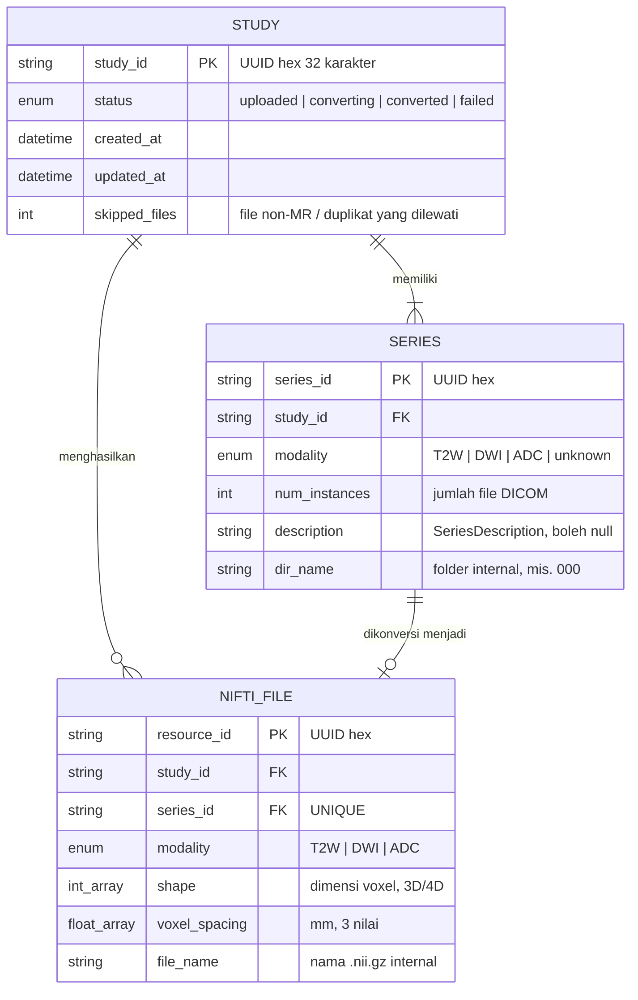
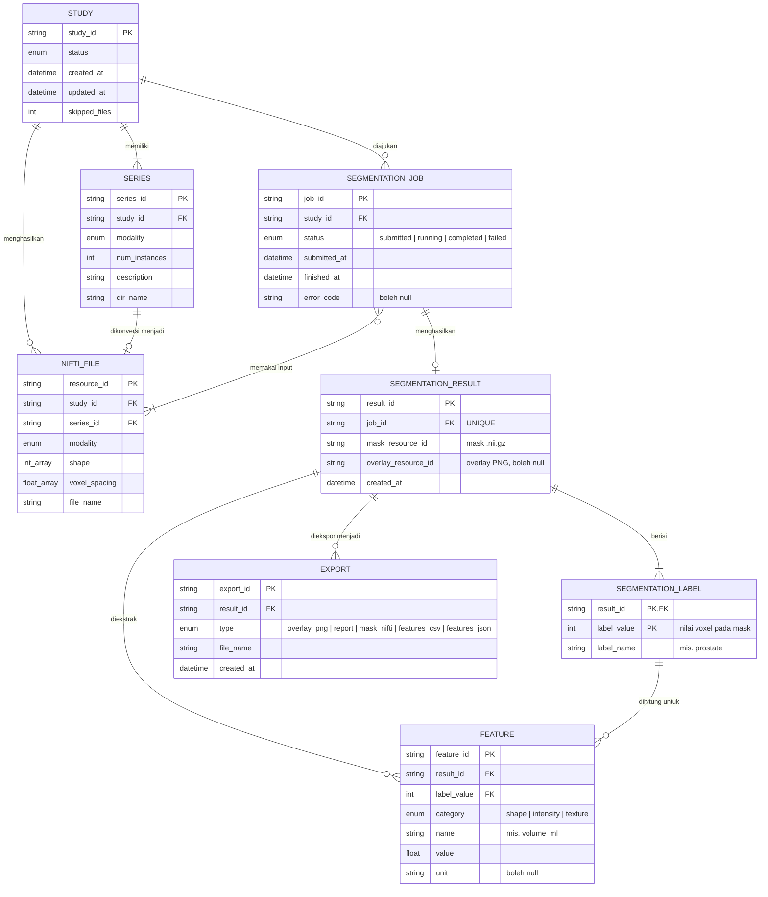
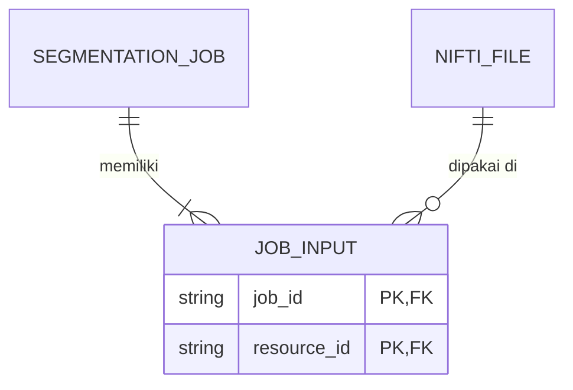

# ERD (Entity Relationship Diagram) — AIRA

Dokumen ini berisi bahan untuk membuat ERD aplikasi AIRA, yaitu daftar entitas, atribut, kunci, dan relasi. Diagram disediakan dalam tiga format:

- **Mermaid**: langsung tampil di GitHub, VS Code, Notion, Obsidian, atau [mermaid.live](https://mermaid.live).
- **DBML**: tempel ke [dbdiagram.io](https://dbdiagram.io) untuk mendapatkan diagram yang bisa diekspor ke PNG/PDF.
- **Tabel atribut**: acuan jika ERD digambar manual, misalnya di draw.io atau Visio.

> **Catatan penting tentang penyimpanan data**
> AIRA saat ini **tidak memakai database relasional**. Data setiap studi disimpan sebagai file `study.json` di folder sementara per studi (`backend/app/services/storage.py`), dan dihapus otomatis setelah 24 jam. *Series* dan *NIfTI file* tersimpan sebagai **daftar bersarang** di dalam studi. ERD di bawah ini memodelkan struktur data tersebut secara logis, sehingga relasi yang di kode tersirat lewat penyusunan bersarang ditulis sebagai *foreign key* (FK).
>
> Selain itu, aplikasi **tidak menyimpan data pasien atau akun pengguna**, sehingga tidak ada entitas `User` atau `Patient`.

---

## 1. Ringkasan Entitas

| Entitas | Status | Sumber di kode | Keterangan |
|---|---|---|---|
| **STUDY** | ✅ Sudah diimplementasikan | `StudyRecord` (`backend/app/models/study.py`) | Satu studi MRI yang diunggah |
| **SERIES** | ✅ Sudah diimplementasikan | `SeriesRecord` | Satu series DICOM dalam studi (T2W/DWI/ADC) |
| **NIFTI_FILE** | ✅ Sudah diimplementasikan | `NiftiRecord` | Volume `.nii.gz` hasil konversi dari satu series |
| **SEGMENTATION_JOB** | 🔶 Rencana (Fase 3) | Spesifikasi API §9 | Permintaan segmentasi ke ML API |
| **SEGMENTATION_RESULT** | 🔶 Rencana (Fase 3–4) | `SegmentationOutput` (`clients/ml_model_client.py`), spesifikasi §9 | *Mask* hasil segmentasi |
| **SEGMENTATION_LABEL** | 🔶 Rencana (Fase 3) | `SegmentationOutput.labels: dict[int, str]` | Label kelas pada *mask* (misalnya 1 = prostat) |
| **FEATURE** | 🔶 Rencana opsional (Fase 5) | Spesifikasi §12 | Fitur bentuk/intensitas/tekstur |
| **EXPORT** | 🔶 Rencana (Fase 5) | Layar Export (`mobile/lib/features/export/`) | File ekspor (PNG, laporan, mask, CSV/JSON) |

Jika ERD hanya ingin menggambarkan sistem yang **sudah berjalan**, cukup gunakan tiga entitas pertama (bagian 3.1).

---

## 2. Domain / Enumerasi

| Enum | Nilai | Dipakai oleh |
|---|---|---|
| `study_status` | `uploaded`, `converting`, `converted`, `failed` | STUDY.status |
| `modality` | `T2W`, `DWI`, `ADC`, `unknown` | SERIES.modality, NIFTI_FILE.modality |
| `job_status` *(rencana)* | `submitted`, `running`, `completed`, `failed` | SEGMENTATION_JOB.status |
| `feature_category` *(rencana)* | `shape`, `intensity`, `texture` | FEATURE.category |
| `export_type` *(rencana)* | `overlay_png`, `report`, `mask_nifti`, `features_csv`, `features_json` | EXPORT.type |

---

## 3. Diagram ERD (Mermaid)

### 3.1 ERD sistem yang sudah berjalan (Fase 1–2)



### 3.2 ERD lengkap (termasuk entitas yang direncanakan)



**Tabel penghubung antara SEGMENTATION_JOB dan NIFTI_FILE (M:N).** Satu *job* bisa memakai beberapa volume (misalnya T2W + DWI + ADC), dan satu volume bisa dipakai oleh beberapa *job*. Jika diagram harus dinormalisasi, tambahkan entitas penghubung:



---

## 4. Kode DBML (untuk dbdiagram.io)

Salin seluruh blok di bawah ini ke [dbdiagram.io](https://dbdiagram.io/d). Tabel bertanda `[rencana]` dapat dihapus jika ERD hanya untuk sistem yang sudah berjalan.

```dbml
Project AIRA {
  Note: 'Model data logis AIRA. Disimpan sebagai study.json per studi (bukan database relasional).'
}

Enum study_status {
  uploaded
  converting
  converted
  failed
}

Enum modality {
  T2W
  DWI
  ADC
  unknown
}

Enum job_status {
  submitted
  running
  completed
  failed
}

Enum feature_category {
  shape
  intensity
  texture
}

Enum export_type {
  overlay_png
  report
  mask_nifti
  features_csv
  features_json
}

// ---------- Sudah diimplementasikan ----------

Table study {
  study_id varchar(32) [pk, note: 'UUID hex dibuat server']
  status study_status [not null, default: 'uploaded']
  created_at timestamp [not null]
  updated_at timestamp [not null]
  skipped_files int [not null, default: 0]
}

Table series {
  series_id varchar(32) [pk]
  study_id varchar(32) [not null, ref: > study.study_id]
  modality modality [not null]
  num_instances int [not null]
  description varchar [null, note: 'DICOM SeriesDescription']
  dir_name varchar [not null, note: 'folder internal, tidak dikirim ke klien']
}

Table nifti_file {
  resource_id varchar(32) [pk]
  study_id varchar(32) [not null, ref: > study.study_id]
  series_id varchar(32) [not null, unique, ref: - series.series_id]
  modality modality [not null]
  shape "int[]" [not null, note: '3 atau 4 dimensi']
  voxel_spacing "float[]" [not null, note: 'mm']
  file_name varchar [not null, note: 'internal, tidak dikirim ke klien']
}

// ---------- [rencana] Fase 3–5 ----------

Table segmentation_job {
  job_id varchar(32) [pk]
  study_id varchar(32) [not null, ref: > study.study_id]
  status job_status [not null, default: 'submitted']
  submitted_at timestamp [not null]
  finished_at timestamp [null]
  error_code varchar [null]
}

Table job_input {
  job_id varchar(32) [ref: > segmentation_job.job_id]
  resource_id varchar(32) [ref: > nifti_file.resource_id]
  indexes {
    (job_id, resource_id) [pk]
  }
}

Table segmentation_result {
  result_id varchar(32) [pk]
  job_id varchar(32) [not null, unique, ref: - segmentation_job.job_id]
  mask_resource_id varchar(32) [not null, note: 'mask .nii.gz']
  overlay_resource_id varchar(32) [null, note: 'overlay PNG']
  created_at timestamp [not null]
}

Table segmentation_label {
  result_id varchar(32) [ref: > segmentation_result.result_id]
  label_value int [note: 'nilai voxel pada mask']
  label_name varchar [not null]
  indexes {
    (result_id, label_value) [pk]
  }
}

Table feature {
  feature_id varchar(32) [pk]
  result_id varchar(32) [not null, ref: > segmentation_result.result_id]
  label_value int [not null]
  category feature_category [not null]
  name varchar [not null]
  value float [not null]
  unit varchar [null]
}

Table export {
  export_id varchar(32) [pk]
  result_id varchar(32) [not null, ref: > segmentation_result.result_id]
  type export_type [not null]
  file_name varchar [not null]
  created_at timestamp [not null]
}

Ref: feature.(result_id, label_value) > segmentation_label.(result_id, label_value)
```

---

## 5. Kamus Data (Tabel Atribut)

### 5.1 STUDY ✅

| Atribut | Tipe | Kunci | Null | Keterangan |
|---|---|---|---|---|
| study_id | varchar(32) | PK | Tidak | UUID heksadesimal yang dibuat server |
| status | enum `study_status` | | Tidak | `uploaded` → `converting` → `converted` / `failed` |
| created_at | timestamp (UTC) | | Tidak | Waktu studi dibuat |
| updated_at | timestamp (UTC) | | Tidak | Diperbarui setiap kali disimpan, dipakai untuk menghitung TTL 24 jam |
| skipped_files | int | | Tidak | Jumlah file yang dibuang (bukan DICOM MR, DICOMDIR, duplikat) |

*Atribut turunan:* `modalities`, yaitu daftar modalitas unik dari series-nya (selain `unknown`). Atribut ini dihitung, tidak disimpan.

### 5.2 SERIES ✅

| Atribut | Tipe | Kunci | Null | Keterangan |
|---|---|---|---|---|
| series_id | varchar(32) | PK | Tidak | UUID heksadesimal (bukan `SeriesInstanceUID` DICOM) |
| study_id | varchar(32) | FK → STUDY | Tidak | Studi pemilik |
| modality | enum `modality` | | Tidak | Hasil klasifikasi heuristik dari header DICOM |
| num_instances | int | | Tidak | Jumlah file DICOM unik dalam series |
| description | varchar | | Ya | `SeriesDescription` dari DICOM |
| dir_name | varchar | | Tidak | Nama folder internal (`000`, `001`, …), tidak dikirim ke aplikasi |

### 5.3 NIFTI_FILE ✅

| Atribut | Tipe | Kunci | Null | Keterangan |
|---|---|---|---|---|
| resource_id | varchar(32) | PK | Tidak | ID opak untuk mengunduh file atau mengambil irisan PNG |
| study_id | varchar(32) | FK → STUDY | Tidak | Studi pemilik |
| series_id | varchar(32) | FK → SERIES, UNIQUE | Tidak | Series sumber konversi |
| modality | enum `modality` | | Tidak | Disalin dari series (T2W/DWI/ADC) |
| shape | int[] | | Tidak | Dimensi volume, misalnya `[384, 384, 24]` |
| voxel_spacing | float[3] | | Tidak | Jarak voxel dalam mm |
| file_name | varchar | | Tidak | Nama file `.nii.gz` internal, tidak dikirim ke aplikasi |

### 5.4 SEGMENTATION_JOB 🔶

| Atribut | Tipe | Kunci | Null | Keterangan |
|---|---|---|---|---|
| job_id | varchar(32) | PK | Tidak | ID tugas segmentasi |
| study_id | varchar(32) | FK → STUDY | Tidak | Studi yang disegmentasi |
| status | enum `job_status` | | Tidak | Status pemrosesan di ML API |
| submitted_at | timestamp | | Tidak | Waktu diajukan |
| finished_at | timestamp | | Ya | Waktu selesai |
| error_code | varchar | | Ya | Kode error jika gagal |

### 5.5 JOB_INPUT 🔶 (entitas penghubung)

| Atribut | Tipe | Kunci | Keterangan |
|---|---|---|---|
| job_id | varchar(32) | PK, FK → SEGMENTATION_JOB | |
| resource_id | varchar(32) | PK, FK → NIFTI_FILE | Volume yang dikirim ke ML API |

### 5.6 SEGMENTATION_RESULT 🔶

| Atribut | Tipe | Kunci | Null | Keterangan |
|---|---|---|---|---|
| result_id | varchar(32) | PK | Tidak | |
| job_id | varchar(32) | FK → SEGMENTATION_JOB, UNIQUE | Tidak | Satu job menghasilkan paling banyak satu hasil |
| mask_resource_id | varchar(32) | | Tidak | *Mask* segmentasi (`.nii.gz`) |
| overlay_resource_id | varchar(32) | | Ya | *Overlay* PNG |
| created_at | timestamp | | Tidak | |

### 5.7 SEGMENTATION_LABEL 🔶

| Atribut | Tipe | Kunci | Keterangan |
|---|---|---|---|
| result_id | varchar(32) | PK, FK → SEGMENTATION_RESULT | |
| label_value | int | PK | Nilai voxel pada *mask* (0 = latar belakang) |
| label_name | varchar | | Nama struktur, misalnya `prostate` |

### 5.8 FEATURE 🔶 (opsional)

| Atribut | Tipe | Kunci | Null | Keterangan |
|---|---|---|---|---|
| feature_id | varchar(32) | PK | Tidak | |
| result_id | varchar(32) | FK → SEGMENTATION_RESULT | Tidak | |
| label_value | int | FK → SEGMENTATION_LABEL | Tidak | Area (ROI) tempat fitur dihitung |
| category | enum `feature_category` | | Tidak | `shape` / `intensity` / `texture` |
| name | varchar | | Tidak | Nama fitur, misalnya `volume_ml` |
| value | float | | Tidak | Nilai fitur |
| unit | varchar | | Ya | Satuan |

### 5.9 EXPORT 🔶

| Atribut | Tipe | Kunci | Null | Keterangan |
|---|---|---|---|---|
| export_id | varchar(32) | PK | Tidak | |
| result_id | varchar(32) | FK → SEGMENTATION_RESULT | Tidak | |
| type | enum `export_type` | | Tidak | Jenis ekspor |
| file_name | varchar | | Tidak | Nama file hasil ekspor |
| created_at | timestamp | | Tidak | |

---

## 6. Relasi dan Kardinalitas

| No | Relasi | Kardinalitas | Penjelasan |
|---|---|---|---|
| 1 | STUDY — **memiliki** — SERIES | 1 : 1..N | Upload yang berhasil selalu menghasilkan minimal satu series. Satu series hanya milik satu studi. |
| 2 | SERIES — **dikonversi menjadi** — NIFTI_FILE | 1 : 0..1 | Hanya series dengan modalitas yang diizinkan (T2W/DWI/ADC) dan berhasil dikonversi yang punya NIfTI. Series `unknown` atau yang gagal dikonversi tidak punya NIfTI. |
| 3 | STUDY — **menghasilkan** — NIFTI_FILE | 1 : 0..N | Studi berstatus `uploaded` belum punya NIfTI. Studi `converted` punya minimal satu, termasuk T2W yang wajib. |
| 4 | STUDY — **diajukan** — SEGMENTATION_JOB 🔶 | 1 : 0..N | Satu studi dapat disegmentasi berkali-kali. |
| 5 | SEGMENTATION_JOB — **memakai input** — NIFTI_FILE 🔶 | M : N (melalui JOB_INPUT) | Satu job memakai satu atau lebih volume. |
| 6 | SEGMENTATION_JOB — **menghasilkan** — SEGMENTATION_RESULT 🔶 | 1 : 0..1 | Job yang gagal tidak menghasilkan hasil. |
| 7 | SEGMENTATION_RESULT — **berisi** — SEGMENTATION_LABEL 🔶 | 1 : 1..N | Setiap *mask* punya minimal satu label. |
| 8 | SEGMENTATION_RESULT — **diekstrak** — FEATURE 🔶 | 1 : 0..N | Fitur bersifat opsional. |
| 9 | SEGMENTATION_LABEL — **dihitung untuk** — FEATURE 🔶 | 1 : 0..N | Setiap fitur dihitung pada satu label/ROI. |
| 10 | SEGMENTATION_RESULT — **diekspor menjadi** — EXPORT 🔶 | 1 : 0..N | Satu hasil bisa diekspor ke beberapa format. |

### Aturan bisnis yang mempengaruhi relasi

- Penghapusan bersifat **kaskade**: menghapus STUDY (manual atau karena TTL 24 jam) ikut menghapus seluruh SERIES, NIFTI_FILE, dan, nantinya, data segmentasinya.
- `dir_name` dan `file_name` adalah atribut **internal** dan tidak pernah dikirim ke aplikasi mobile. Aplikasi hanya menerima ID opak.
- Konversi wajib menghasilkan NIFTI_FILE dengan modalitas **T2W**. Tanpa itu, konversi dibatalkan dan tidak ada NIFTI_FILE yang tersimpan.

---

## 7. Notasi Chen (untuk digambar manual)

Jika ERD harus memakai notasi Chen (entitas = persegi panjang, relasi = belah ketupat, atribut = elips), gunakan pemetaan berikut:

```text
[STUDY] ──1──< memiliki >──N── [SERIES] ──1──< dikonversi >──0..1── [NIFTI_FILE]
   │                                                                    │
   1                                                                    M
   │                                                                    │
< diajukan >                                                       < memakai >
   │                                                                    │
   N                                                                    N
   │                                                                    │
[SEGMENTATION_JOB] ─────────────────────────────────────────────────────┘
   │
   1
< menghasilkan >
   0..1
   │
[SEGMENTATION_RESULT] ──1──< berisi >──N── [SEGMENTATION_LABEL]
   │            │                                   │
   1            1                                   1
< diekspor >  < diekstrak >──N── [FEATURE] ──N──< dihitung untuk >
   N
   │
[EXPORT]
```

Atribut kunci (PK) digarisbawahi pada elips: `study_id`, `series_id`, `resource_id`, `job_id`, `result_id`, `feature_id`, `export_id`. SEGMENTATION_LABEL adalah **entitas lemah** dengan kunci parsial `label_value` yang bergantung pada SEGMENTATION_RESULT.
